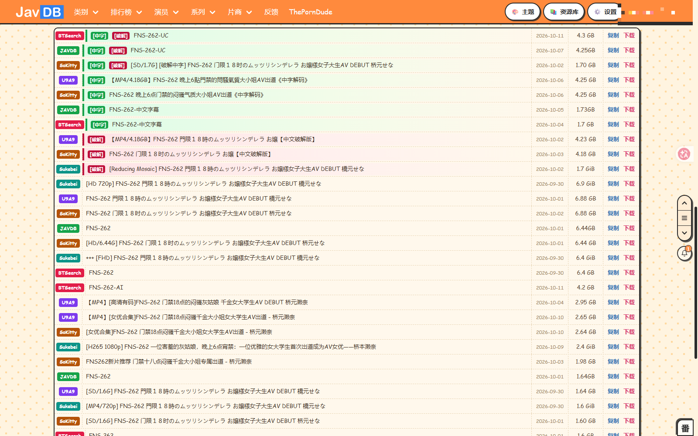

# JAVDB全能助手

> JAVDB 一站式增强浏览器扩展：媒体库入库同步、在线播放、预告片、预览图、磁力链聚合、多站点搜索、免 VIP 榜单，即装即用。

---

## 📸 功能实拍

### 🏠 列表页 — 媒体库入库状态 + 快捷操作

每张卡片实时显示 **Emby / Jellyfin 入库徽标**，一眼分辨哪些已在库；封面下方一排快捷按钮，复制磁力、查看预览、快捷搜索一步到位。支持「已入库列表」快速筛选。

### 🎬 详情页 — 快捷工具条 + 一键播放

详情页顶部完整快捷工具条：下载封面、翻译标题、屏蔽作品、找片、在线播放、复制演员等；一键跳转 Emby / Jellyfin 入库状态，底部聚合 98公 / JavBus / Sukebei / FANZA / MissAV / AVBase 多站点入口。

### 🧲 磁力链多源聚合

详情页磁力页聚合 **BTSearch / JAVDB / Sukebei / USAO** 等多个磁力源，自动标注中字 / 破解 / 无码，按日期与体积排列，一键复制或下载。

### 🖼️ 影片预览图

详情页一键查看影片预览图，多源并行加载快速出图，支持侧边快捷面板直达发到手机、磁力、在线播放等功能。

## ✨ 更多特性

| 分类 | 能力 |
|------|------|
| **媒体库入库同步** | Emby / Jellyfin 双服务器，列表页 & 详情页实时显示入库标签；支持一键跳转媒体库直接播放 |
| **资源库** | 扩展内统一管理媒体库、资讯库、入库记录；想看库、收藏、筛选一站式 |
| **在线播放** | 多视频源智能竞速，HLS 流式播放，页内弹层不跳转，画质 / 倍速 / 音量记忆 |
| **预告片** | 详情页一键唤起官方预告片播放器 |
| **免 VIP** | 热播排行 / Top250 / FC2PPV / 相关清单 / 全部评论，全部免 VIP 直接看 |
| **多站点搜索** | 番号一键跳转多个站点，自定义站点列表 |
| **以图搜图** | 截图 / 拖拽 / 粘贴上传，自动识别演员与影片 |
| **界面增强** | 无缝翻页、卡片列数与页面宽度自由调节、多套主题（含动漫卡通风）、暗色模式全面适配 |
| **账号体系** | 云端备份与恢复、消息中心、多账号数据完全隔离 |
| **字幕** | 字幕搜索与下载，日译中辅助 |

## 📥 下载与安装

**安装包与完整安装教程请移步 <a href="https://github.com/dmdx-cc/JavdbBuddy/releases" target="_blank">Releases</a>** —— 每个版本附带对应平台的安装包与安装说明。

也可以访问官网页面获取最新版本与介绍：**<a href="https://www.dmdx.cc/#javdbbuddy" target="_blank">JAVDB全能助手 · 官网</a>**

## 📇 联系方式

点击名称即可在新标签页打开：

<table>
  <tr>
    <td><a href="https://www.dmdx.cc/#javdbbuddy" target="_blank"> 官网（代码独行）</a></td>
    <td><a href="https://github.com/dmdx-cc/JavdbBuddy" target="_blank"> GitHub 仓库</a></td>
    <td><a href="https://gitee.com/lfsnd/javdb-all-in-one-assistant" target="_blank"> Gitee 仓库</a></td>
  </tr>
  <tr>
    <td><a href="https://t.me/xsgz6" target="_blank"> Telegram 私聊</a></td>
    <td><a href="https://t.me/javdbbuddy" target="_blank"> Telegram 频道</a></td>
    <td><a href="https://t.me/avdbbuddy_qz" target="_blank"> Telegram 群组</a></td>
  </tr>
</table>

## ⭐ 支持

如果这个扩展对你有帮助，欢迎给个 Star ⭐ 鼓励一下！
